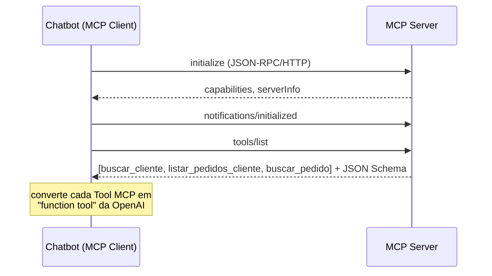
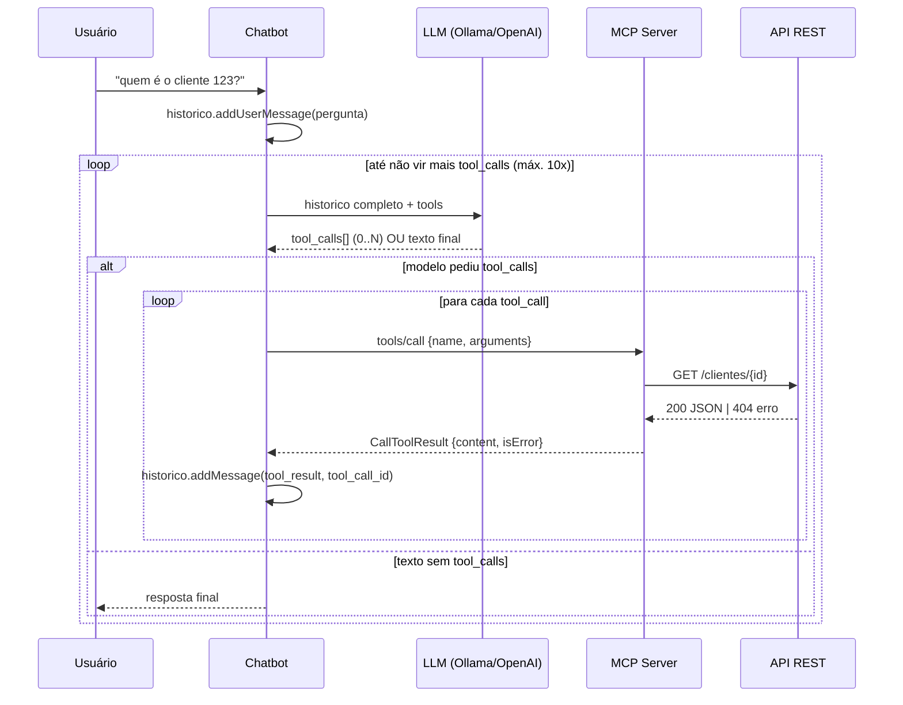

# Entrega final — Chatbot + MCP + API REST

Este documento fecha o projeto de aprendizado das 9 etapas: `api-rest/`, `mcp-server/` e `chatbot/`, integrados via MCP (Model Context Protocol) e um LLM (OpenAI ou Ollama local).

## Índice

- [Como subir tudo (Docker Compose)](#como-subir-tudo-docker-compose)
- [Diagrama do fluxo completo](#diagrama-do-fluxo-completo)
- [Glossário](#glossário)
- [Para produção](#para-produção)

---

## Como subir tudo (Docker Compose)

Extra opcional, fora das 9 etapas de aprendizado (que rodam com `mvn spring-boot:run` / `java -jar` puro, sem Docker).

```
chatbot-mcp/
├── docker-compose.yml
├── .env.example
├── api-rest/Dockerfile
├── mcp-server/Dockerfile
└── chatbot/Dockerfile
```

```bash
cp .env.example .env          # ajuste se quiser usar OpenAI de verdade em vez de Ollama
docker compose up -d api-rest mcp-server
docker compose run --rm chatbot --debug
```

Validado rodando de verdade: `chatbot` (container) → `mcp-server:8081` (container, via DNS do compose) → `api-rest:8080` (container) → volta; e `chatbot` → Ollama do **host** via `host.docker.internal:11434` (Ollama fica de fora do compose de propósito, para não perder aceleração de GPU nem duplicar o download dos modelos).

Detalhe corrigido no processo: `Main.java` tinha a URL do mcp-server hardcoded em `localhost:8081`, o que quebra em rede Docker — [chatbot/src/main/java/br/com/chatbotmcp/chatbot/Main.java](chatbot/src/main/java/br/com/chatbotmcp/chatbot/Main.java) agora lê `MCP_SERVER_URL` do ambiente (default `http://localhost:8081` para uso local).

Isso contraria a restrição original do projeto de "tudo local, sem Docker" — por isso ficou como extra opcional, e não como parte das 9 etapas.

---

## Diagrama do fluxo completo

### Inicialização (uma vez, ao subir o chatbot)



### Por pergunta (o loop de tool calling)



---

## Glossário

- **LLM (Large Language Model)** — o modelo (`llama3.1` via Ollama, ou `gpt-5.1-mini` na OpenAI) que recebe texto e prevê o próximo texto. Não executa código, não acessa banco de dados, não "sabe" nada além do que está no seu histórico de treino + no que você manda na requisição.
- **Contexto da conversa** — tudo que é reenviado ao modelo a cada chamada: system prompt, perguntas, respostas anteriores, tool calls e seus resultados. O modelo é **stateless**: ele não lembra de nada entre chamadas HTTP — a "memória" da conversa é inteiramente esse histórico que você (o chatbot) mantém e reenvia (`chatbot/src/main/java/br/com/chatbotmcp/chatbot/loop/ToolCallingLoop.java`).
- **Tool calling** — em vez de só gerar texto, o modelo pode devolver "quero chamar a função X com estes argumentos". Quem decide *se* e *quando* chamar é o modelo; quem *executa* de fato é o seu código.
- **Loop de execução de ferramentas** — o ciclo "manda histórico → modelo pede tool → executa → devolve resultado → manda histórico de novo" até o modelo responder só com texto. Implementado em `ToolCallingLoop.executar()`, com limite de 10 iterações contra loop infinito.
- **MCP Server** — processo que expõe um conjunto de *tools* via um protocolo padronizado (JSON-RPC sobre HTTP, neste projeto). Ele traduz "o LLM quer buscar o cliente 123" em uma chamada real (`GET /clientes/123` na api-rest). Não sabe nada sobre OpenAI/Ollama.
- **MCP Tool** — uma função exposta pelo MCP Server: `name` + `description` (escrita para o LLM entender quando usar) + `inputSchema` (JSON Schema dos argumentos). Diferente de um endpoint REST, uma tool é descoberta *em runtime* (`tools/list`), não documentada estaticamente.
- **MCP Client** — a parte que fala com o MCP Server: faz o handshake, lista tools, executa `tools/call`. No projeto, é `McpToolsClient.java`, usando o SDK oficial.
- **`initialize`** — primeira mensagem JSON-RPC da conversa MCP: negocia versão do protocolo e capabilities de cada lado, devolve `serverInfo`.
- **`tools/list`** — pergunta "quais tools você tem?". Resposta: array de `{name, description, inputSchema}` — é isso que vira "function tools" da OpenAI.
- **`tools/call`** — "execute a tool X com estes argumentos". Resposta: `CallToolResult` com `content` (texto) e `isError` (nunca uma exceção de transporte).
- **API REST** — a aplicação `api-rest`, que não sabe nada sobre MCP ou LLM. Só serve dados de clientes/pedidos via HTTP/JSON. O MCP Server é a única coisa que fala com ela.

---

## Para produção

| Área | O que mudaria | Por quê |
|---|---|---|
| **Autenticação no MCP Server** | Hoje `/mcp` não pede nada. Adicionar API key, mTLS ou OAuth2 (o MCP spec já prevê fluxo OAuth). | Qualquer processo na rede pode chamar as tools hoje. |
| **Timeouts** | `ApiRestClient` não define timeout na chamada à api-rest; se ela travar, a tool trava junto, travando o turno inteiro do chat. | Um serviço lento não pode travar o assistente inteiro. |
| **Retries** | Nenhum retry em nenhuma das 3 chamadas de rede (chatbot→MCP, MCP→api-rest, chatbot→LLM). | Falhas transitórias de rede não deveriam virar erro visível ao usuário. |
| **Observabilidade** | Sem métricas, tracing ou log estruturado. Hoje só temos `--debug` no console. | Em produção você precisa saber quantas tool calls por minuto, latência por tool, taxa de erro por tool — não dá pra debugar lendo stdout. |
| **Gestão de contexto** | Histórico cresce sem limite a cada pergunta — reenviado por inteiro sempre. | Eventualmente estoura a janela de contexto do modelo e o custo por chamada cresce linearmente. Mitigar com: truncar mensagens antigas, resumir o histórico periodicamente, ou usar o mecanismo de estado nativo da Responses API (`previous_response_id`) em vez de reenviar tudo. |
| **Custos** | Cada pergunta com tool calling manda o histórico inteiro + descrições de todas as tools, em cada iteração do loop. | Descrições de tool longas e histórico grande = tokens de entrada caros, multiplicados por cada iteração do loop (vimos até 2-3 iterações por pergunta nos testes). Vale medir tokens reais e considerar cachear o system prompt. |
| **Segurança dos argumentos vindos do LLM** | O mcp-server hoje confia razoavelmente nos argumentos (valida tipo/presença, mas não teto de tamanho, nem sanitização de string). | Um LLM comprometido ou mal-instruído (prompt injection vindo de um resultado de tool anterior, por exemplo) pode tentar mandar argumentos maliciosos. Nunca use argumentos de LLM para montar queries SQL diretas, paths de arquivo, ou comandos de shell sem validação estrita — nossas tools já são seguras nesse sentido porque só repassam um `id` numérico para um `RestClient`, mas isso deixa de ser trivial com tools mais poderosas. |
